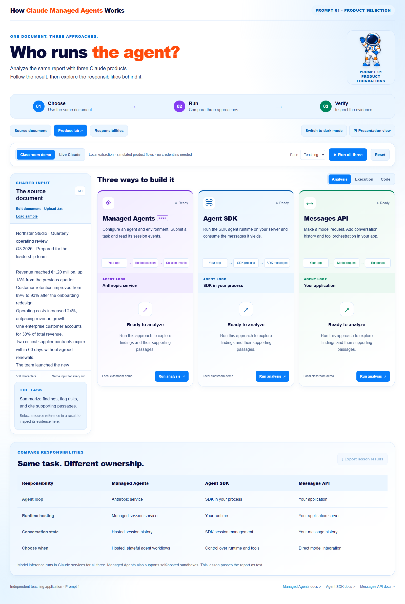
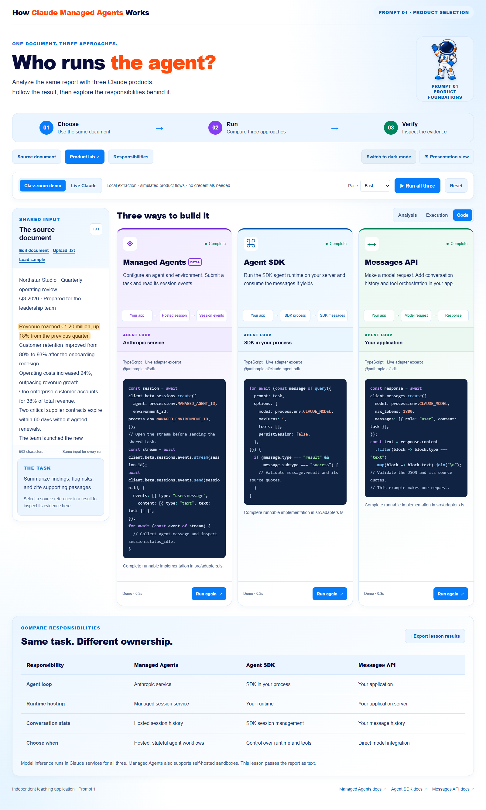
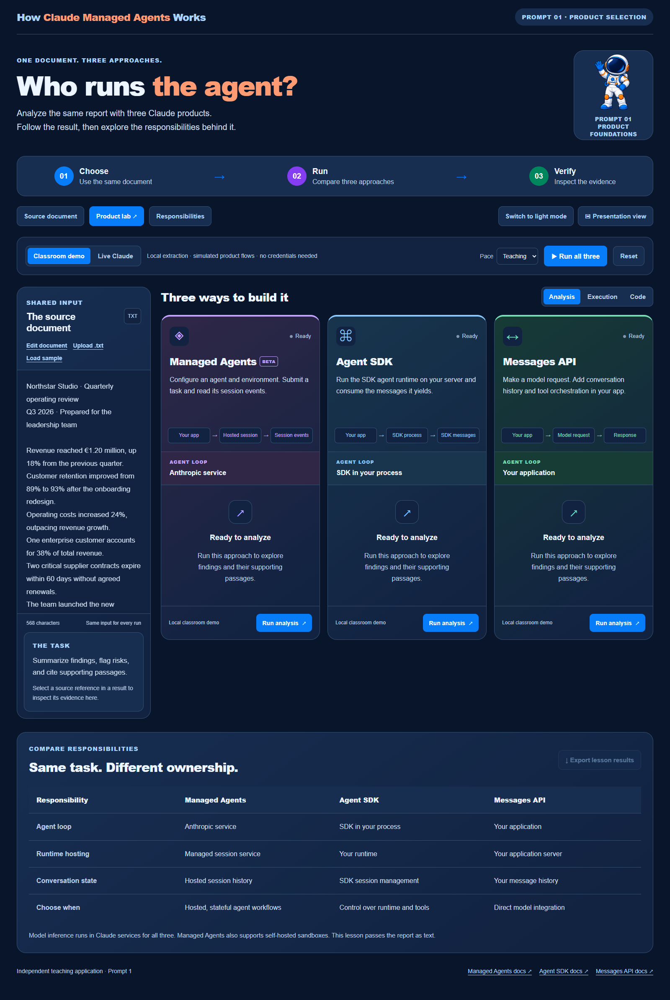

<div align="center">

# Claude Managed Agents
## 180 Practical Applications

**Build your understanding of AI agents by running, changing and testing real TypeScript applications.**

From your first agent workflow to tools, MCP, permissions, memory, multiagent coordination and complete classroom projects.

**180 runnable labs · 22 learning sections · TypeScript · Guided exercises**

By [Luis Coco Enríquez](https://github.com/luiscoco)

[Start your first lab](#run-your-first-application) · [Explore the curriculum](docs/CURRICULUM.md) · [About the Udemy course](#take-the-course)



</div>

## Turn agent concepts into practical skills

What happens when a session stops? How should a tool reject invalid input? Where does human approval belong in an agent workflow?

Work through these questions in applications you can inspect. Run a guided exercise, watch its results, read the implementation, then change an input and test your understanding. Each numbered lesson has its own source code, interface, dependency lockfile and tests.

This repository is the student companion to **Claude Managed Agents: 180 Practical Applications**, an upcoming Udemy course. You can explore the source and begin the local exercises before the course launches.

> **Start without an API key.** The classroom exercises use local fixtures. Lessons with optional live adapters explain their separate credential requirements. Lessons 9–180 simulate hosted provider operations; they do not deploy 172 hosted agents. See [exactly what runs locally](docs/EXECUTION-SCOPE.md).

## What you will practice

| Skill | Your practical work |
| --- | --- |
| Agent foundations | Compare product approaches, inspect architecture and configure reusable agent definitions. |
| Sessions and events | Follow lifecycle transitions, render streaming events and explore reconnection behavior. |
| Tools and MCP | Validate inputs, handle failures, control tool access and inspect integration flows. |
| Permissions and credentials | Exercise approval gates, denied operations and credential-handling boundaries. |
| Memory and coordination | Explore conflicting edits, specialists, threads and branching workflows. |
| Operational thinking | Inspect outcomes, webhook signatures, usage fixtures and budget controls. |
| Complete projects | Trace an end-to-end workflow across inputs, actions, evidence and reviewed outputs. |

## Why learn with these labs?

- **Follow the behavior, then read the code.** Each interface makes the lesson's state changes and results visible.
- **Practice the failure cases.** Conflicts, missing permissions and rejected inputs are part of the exercises.
- **Keep your bearings.** Numbered folders match the curriculum, and each lesson has a guided walkthrough.
- **Study comfortably.** Light/dark themes, readable code, coloured syntax highlighting and presentation mode support focused learning.
- **Make each lesson your own.** Edit a control, change a handler, add an assertion and explain the new behavior.



## Run your first application

Install **Node.js 24 or later**, including npm, and use a modern browser. Git is optional if you download the ZIP through GitHub's **Code → Download ZIP** menu.

```shell
git clone https://github.com/luiscoco/Udemy-Claude-Managed-Agents-180-Prompts-Learn-from-Zero.git
cd Udemy-Claude-Managed-Agents-180-Prompts-Learn-from-Zero
npm run setup -- 1
npm start -- 1
```

Open **http://127.0.0.1:4010**. In the first lab, keep **Classroom demo** selected, choose **Run all three**, compare the results and explore the code view.

Stop the server with **Ctrl+C**. Choose another lesson by changing its number:

```shell
npm run setup -- 9
npm start -- 9
```

Lesson 9 opens at **http://127.0.0.1:4090/**. Find every lesson's URL in the [full curriculum](docs/CURRICULUM.md).

The setup command installs dependencies for the selected lesson. It does not require installing all 180 applications. For manual installation, browser testing and common fixes, see the [setup guide](docs/SETUP.md).

## Your path through the course

| Stage | Lessons | Focus |
| --- | --- | --- |
| Foundations | 1–8 | Product selection, architecture, setup, authentication and first execution. |
| Agent runtime | 9–46 | Definitions, environments, sessions, events and context. |
| Tools and integration | 47–88 | Built-in tools, custom tools, MCP, approval policies and credentials. |
| Context and collaboration | 89–136 | Skills, files, GitHub concepts, memory, specialists and workflows. |
| Operations | 137–170 | Outcomes, schedules, webhooks, observability, budgets and sandbox variants. |
| Complete projects | 171–180 | Application patterns, tests and combined classroom projects. |

**[Browse all 180 lessons →](docs/CURRICULUM.md)**

Prefer a focused route? Try the [recommended learning paths](docs/LEARNING-PATHS.md). Use the [practice workbook](docs/PRACTICE.md) to turn each exercise into a small piece of portfolio evidence.

## Who is this for?

Developers who know basic JavaScript or TypeScript and want practical experience with agent application concepts. It also suits technical leads who want to inspect how state, tools, approvals and evidence fit together.

You should be comfortable opening a terminal, installing npm dependencies and reading basic asynchronous JavaScript. Live provider exercises may require a separate account, compatible resources and paid usage; local classroom exercises need no provider credentials.

## What is included?

```text
apps/
  prompt-01/ ... prompt-180/   Numbered applications with source and tests
  course-lab/                 Combined classroom browser for Lessons 9–180
docs/
  CURRICULUM.md               All 180 lessons and local URLs
  SETUP.md                    Installation, testing and troubleshooting
  EXECUTION-SCOPE.md          Classroom fixtures and optional live behavior
  LEARNING-PATHS.md           Routes through the material
  PRACTICE.md                 Exercises and a completion checklist
scripts/                     Student launcher and repository verification
```

Videos, narrated exports and instructor production files are distributed separately. This repository contains the application source and student documentation.

<details>
<summary><strong>Preview the dark theme</strong></summary>



</details>

## Take the course

**Udemy course: coming soon.**

The planned course pairs these applications with guided video explanations and walkthroughs. Use the repository now to preview the exercises and get your environment ready. The enrollment link will be added here once the course is published.

**Already learning from the source?** Start with Lesson 1, complete its exercise and keep a note of what you changed. That first working result is your starting point for the rest of the course.

## Frequently asked questions

**Do I need an Anthropic API key?**  
No key is needed for the default classroom exercises. Optional live modes have separate instructions. Keep credentials in a local `.env` file and never commit them.

**Are all 180 applications included?**  
Yes. Each numbered folder contains source code, frontend assets, tests, a package file, a dependency lockfile and instructions. Check coverage with `npm run verify:catalog`.

**Do these exercises provision production infrastructure?**  
The classroom applications run locally. Most provider operations are simulations, and illustrative reference snippets are labelled separately. Some foundation lessons include optional live adapters. Read the [execution scope](docs/EXECUTION-SCOPE.md) before connecting an account.

**Can I study one lesson at a time?**  
Yes. Use the root launcher or install directly inside a numbered folder. Start with the foundations if the concepts are new to you.

**Will the API examples stay identical over time?**  
The lockfiles preserve the course dependency versions. Provider APIs and previews can change; verify current provider documentation before adapting a reference snippet to a live integration.

## Questions, fixes and responsible sharing

For an application problem, [open an issue](https://github.com/luiscoco/Udemy-Claude-Managed-Agents-180-Prompts-Learn-from-Zero/issues/new/choose) with the lesson number, Node.js version and reproducible steps. Share sanitised errors only. After the Udemy course launches, use its Q&A for course-content questions.

If the labs help you, consider starring the repository so you can find it again and sharing its link with another developer.

Created by **Luis Coco Enríquez**. This is an independent educational project; it is not an official Anthropic or Udemy product. See [usage and attribution](COPYRIGHT.md).
